<div align="center">

# Robot Manipulator Management System
### A Web-Based System for Monitoring, Reservation and Maintenance of Laboratory Robotic Manipulators

**Software Engineering — Project Report**

**Aaron Joshua**
Registration No: **24BRS1393**
Vellore Institute of Technology (VIT), Chennai

</div>

---

## Table of Contents

1. [Introduction](#1-introduction)
2. [Literature Survey / Existing System](#2-literature-survey--existing-system)
3. [Software Process Model and Project Planning](#3-software-process-model-and-project-planning)
4. [Requirements Analysis](#4-requirements-analysis)
5. [System Design](#5-system-design)
6. [Implementation](#6-implementation)
7. [Software Tools Used](#7-software-tools-used)
8. [Testing](#8-testing)
9. [Results and Discussion](#9-results-and-discussion)
10. [Conclusion and Future Enhancements](#10-conclusion-and-future-enhancements)
11. [References](#11-references)
12. [Appendices](#12-appendices)

---

## 1. Introduction

### 1.1 Background and Motivation
Modern engineering and research laboratories increasingly host a fleet of **robotic manipulators** —
articulated arms, collaborative robots (cobots), SCARA, delta and Cartesian systems — that are shared
among many students, researchers and technicians. These machines are expensive capital assets with
finite service life: their joints, harmonic drives and actuators wear with cumulative operating hours
and must be serviced at defined intervals.

In practice, labs often track this information informally — a whiteboard showing which arm is "busy",
a spreadsheet of maintenance dates, or simply tribal knowledge. This leads to **double-booking**,
**under-utilised equipment**, **missed preventive maintenance**, and no single source of truth for the
condition of each robot. As the number of machines grows, the problem becomes unmanageable.

This motivated the development of the **Robot Manipulator Management System (RMMS)**: a lightweight,
web-based platform that gives a lab a single dashboard to see every connected robot, its real-time
availability (free / in use), its wear condition, and its complete technical and maintenance history.

### 1.2 Problem Statement
> *Laboratories that operate multiple robotic manipulators lack a centralised system to monitor
> availability, track equipment wear, coordinate reservations, and manage maintenance. The absence
> of such a system results in scheduling conflicts, poor asset utilisation and unplanned downtime.*

RMMS addresses this by providing role-based access (users and administrators), a live status
dashboard, a reservation (check-out/check-in) workflow that automatically accrues operating hours and
recomputes wear, and administrative tools for fleet and maintenance management.

### 1.3 Objectives
1. Provide a **centralised dashboard** summarising fleet status, utilisation and wear at a glance.
2. Maintain a **catalogue** of robots with full specifications and search/filter capability.
3. Implement a **reservation workflow** so users can check robots out and back in, preventing conflicts.
4. **Model and track wear** automatically from accumulated operating hours against a service interval.
5. Enable administrators to **manage the fleet** (CRUD) and **log maintenance**, resetting wear on service.
6. Enforce **role-based access control** with secure authentication (hashed passwords, signed sessions).
7. Deliver a **responsive, usable interface** suitable for desktop and tablet use in a lab.

### 1.4 Scope and Limitations
**In scope**
- User registration/login and admin/user roles.
- Robot catalogue, dashboard analytics, reservation lifecycle, maintenance logging, user management.
- A relational database with referential integrity and a documented REST API.
- Automated test suite covering the core logic and API.

**Out of scope / Limitations**
- **No direct hardware integration.** RMMS is a *management* layer; operating hours are logged on
  check-in rather than read live from a robot controller (e.g. ROS, PROFINET). A hardware telemetry
  adapter is proposed as future work.
- Single-server deployment with an embedded SQLite database (appropriate for a lab; not a
  multi-tenant cloud product).
- Scheduling is immediate check-out/check-in rather than calendar-based future booking.
- Notifications (email/SMS) and analytics export are not implemented in this version.

---

## 2. Literature Survey / Existing System

### 2.1 Review of Existing Systems
| System / Category | Primary purpose | Relevance & limitation for a robot lab |
|---|---|---|
| **CMMS** (e.g. Fiix, UpKeep, eMaintenance) | Computerised Maintenance Management for industrial assets | Strong on work orders & maintenance, but heavyweight, licensed, and not oriented to self-service *reservation* of shared lab equipment. |
| **Lab equipment booking tools** (e.g. Clustermarket, Bookkit, NEMO) | Calendar reservation of instruments | Good for scheduling, but treat equipment as opaque "resources" with no concept of mechanical **wear** or robot-specific specifications. |
| **MES / fleet dashboards** (vendor tools: ABB RobotStudio, FANUC ZDT, KUKA Connect) | Vendor-specific robot telemetry & monitoring | Powerful condition monitoring, but **single-vendor**, expensive, and cannot present a *mixed-brand* lab fleet (KUKA + ABB + UR + …) in one place. |
| **Spreadsheets / whiteboards** | Ad-hoc tracking | Zero cost and familiar, but no concurrency control, no access roles, error-prone, and no analytics. |

### 2.2 Gaps Identified and Proposed Solution
**Gaps**
- No single tool combines **availability/reservation** *and* **wear/maintenance tracking** for a
  **multi-vendor** fleet of manipulators.
- Vendor monitoring tools are siloed; general booking tools ignore equipment health.
- Low-cost options (spreadsheets) lack access control, integrity and a real-time view.

**Proposed solution (RMMS)** — a vendor-neutral, open, lightweight web application that unifies:
*fleet dashboard + specifications catalogue + reservation lifecycle + wear model + maintenance log +
role-based administration*, deployable on a single modest server with no licensing cost.

---

## 3. Software Process Model and Project Planning

### 3.1 SDLC Model Chosen — Agile (Scrum-lite) with Iterative Increments
An **Agile, iteration-based** model was chosen over Waterfall because:
- Requirements for the dashboard and wear model were expected to **evolve** as early prototypes were seen.
- The project naturally decomposes into **independently demonstrable increments** (auth → catalogue →
  reservations → maintenance → analytics), each producing working software.
- A single developer benefits from **short feedback loops** and continuous integration of tested code
  rather than a single big-bang integration at the end.

Work was organised into four short sprints, each ending with a runnable, tested increment.

### 3.2 Project Schedule (Sprint Plan)
| Sprint | Duration | Goals / Increment | Key deliverables |
|---|---|---|---|
| **Sprint 0 — Setup** | Week 1 | Project skeleton, DB schema, auth | Express app, SQLite schema, login/register |
| **Sprint 1 — Catalogue** | Week 2 | Robot model, listing, search/filter, detail | `/api/robots`, robot grid & detail UI |
| **Sprint 2 — Reservations** | Week 3 | Reserve/release, wear model, dashboard | Reservation lifecycle, stats, charts |
| **Sprint 3 — Admin & QA** | Week 4 | Fleet CRUD, maintenance, user mgmt, tests, docs | Admin tools, test suite, report & diagrams |

**Gantt (sprint timeline):**

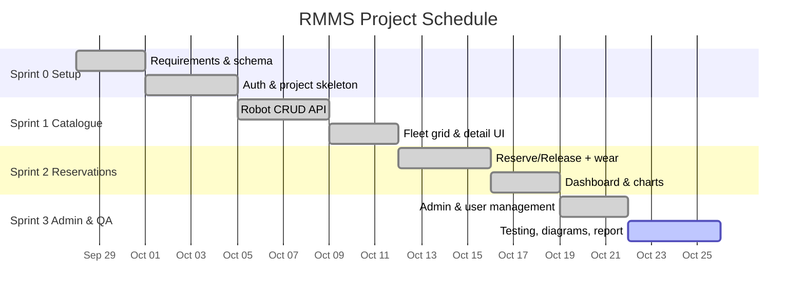

### 3.3 Risk Analysis
| # | Risk | Likelihood | Impact | Mitigation |
|---|---|---|---|---|
| R1 | Scope creep (live hardware telemetry) | Medium | High | Fixed scope to a management layer; telemetry deferred to future work |
| R2 | Data integrity (orphaned reservations/logs) | Medium | High | Foreign keys + `ON DELETE CASCADE`; transactions around reserve/release |
| R3 | Concurrency — two users reserve the same robot | Low | Medium | Server-side status check inside a transaction; status flips atomically |
| R4 | Security — password/credential leakage | Low | High | scrypt hashing + per-user salt; signed, expiring tokens; no secrets in client |
| R5 | Environment/setup friction for evaluation | Medium | Medium | Single dependency, built-in SQLite, auto-seed on first run, documented steps |
| R6 | Single-developer time constraints | Medium | Medium | Agile increments; each sprint ships a usable subset |

### 3.4 Cost / Effort Estimation (Optional)
A simplified estimate using **effort = size × productivity**:
- Approx. source size: ~1,600 LOC (≈ 0.0016 KLOC… i.e. 1.6 KLOC).
- Using a small-project heuristic of ~1 person-week per ~400 LOC of full-stack code → **~4 person-weeks**,
  matching the 4-sprint plan.
- **Tooling cost: ₹0** — all tools used (Node.js, Express, SQLite, VS Code, Git, Mermaid) are free/open-source.

---

## 4. Requirements Analysis

### 4.1 Functional Requirements
| ID | Requirement |
|---|---|
| FR1 | A visitor can **register** a user account and **log in**; invalid credentials are rejected. |
| FR2 | The system distinguishes **two roles** — *user* and *administrator* — and restricts features accordingly. |
| FR3 | An authenticated user can **view the dashboard**: counts by status, average wear, utilisation, charts. |
| FR4 | A user can **browse, search and filter** robots by status, category and free-text. |
| FR5 | A user can **view full details** of a robot including specifications, wear and maintenance history. |
| FR6 | A user can **reserve** a *free* robot; the robot becomes *in use* and a reservation record is created. |
| FR7 | A user (or admin) can **release** a robot, logging the hours used; the system updates operating hours and **recomputes wear**. |
| FR8 | A user can **view their own reservations**; an admin can view **all** reservations. |
| FR9 | An admin can **create, edit and delete** robots. |
| FR10 | An admin can **log maintenance** against a robot and optionally **reset its wear clock**. |
| FR11 | An admin can **list users, change roles and delete users** (but not demote/delete their own account). |
| FR12 | The system **prevents reserving** a robot that is not free (returns a conflict). |

### 4.2 Non-Functional Requirements
| ID | Category | Requirement |
|---|---|---|
| NFR1 | Security | Passwords stored only as scrypt hashes with per-user salts; sessions use signed, expiring tokens. |
| NFR2 | Performance | Dashboard and list endpoints respond in < 200 ms for a lab-scale fleet (tens–hundreds of robots). |
| NFR3 | Usability | Responsive dark UI; primary tasks reachable in ≤ 3 clicks; clear status colour-coding. |
| NFR4 | Reliability | Referential integrity enforced; reserve/release/maintenance run in transactions. |
| NFR5 | Portability | Runs on any OS with Node.js ≥ 22.5; no native build steps; embedded database. |
| NFR6 | Maintainability | Modular routes, shared helpers, documented REST API, automated tests. |
| NFR7 | Scalability | Stateless auth tokens allow horizontal scaling of the API tier. |

### 4.3 Software Requirements Specification (SRS) Summary
- **Purpose:** centralise monitoring, reservation and maintenance of shared lab robotic manipulators.
- **Users:** *Lab Users* (browse, reserve, release, view own history) and *Administrators* (all of the
  above plus fleet CRUD, maintenance logging, user management).
- **Interfaces:** a browser-based single-page UI and a JSON REST API over HTTP.
- **Data:** four entities — `users`, `robots`, `reservations`, `maintenance_logs` (see §5.5).
- **Constraints:** single-server deployment; wear derived from logged hours (no live telemetry).
- **Assumptions:** one active reservation per robot at a time; operating hours logged honestly on check-in.

### 4.4 Hardware and Software Requirements
**Software**
| Item | Requirement |
|---|---|
| Runtime | Node.js **≥ 22.5** (built-in SQLite) |
| Dependency | Express.js ^4.19 |
| Browser | Any modern browser (Chrome/Edge/Firefox) |
| OS | Windows / macOS / Linux |

**Hardware (minimum, for server)**
| Item | Requirement |
|---|---|
| CPU | Dual-core 1.5 GHz+ |
| RAM | 512 MB+ (1 GB recommended) |
| Disk | ~100 MB (app + database) |
| Network | LAN/HTTP access for clients |

---

## 5. System Design

### 5.1 System Architecture
RMMS follows a classic **three-tier architecture**: a browser-based presentation tier, a Node.js/Express
application tier exposing a stateless REST API, and a SQLite data tier. The tiers communicate over
HTTP/JSON; the client holds a signed session token and sends it as a `Bearer` header.

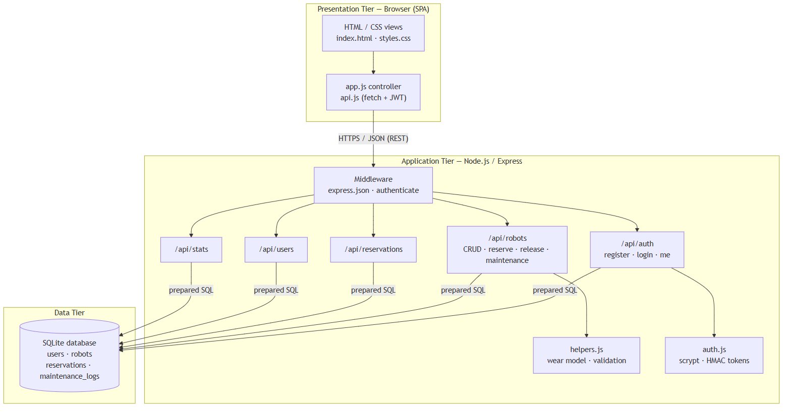

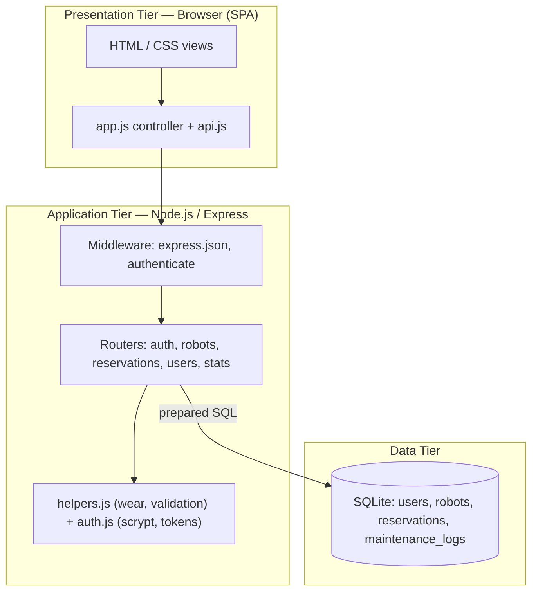

### 5.2 Use Case Diagram
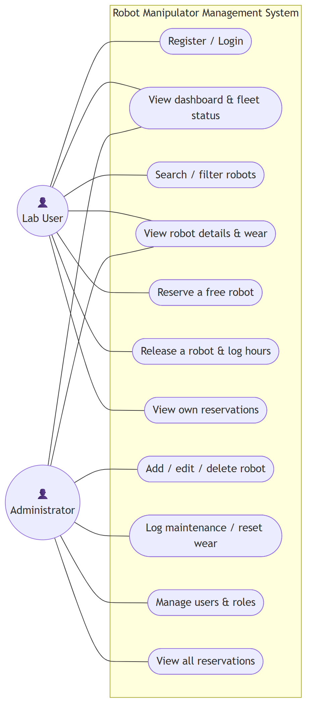

**Primary actors:** *Lab User* and *Administrator* (an administrator can perform all user actions plus
administrative ones).

### 5.3 Class Diagram
The domain is modelled as four core entities. Behaviour such as `computeWear()`, `reserve()` and
`release()` is implemented in the corresponding route/service modules operating on these records.

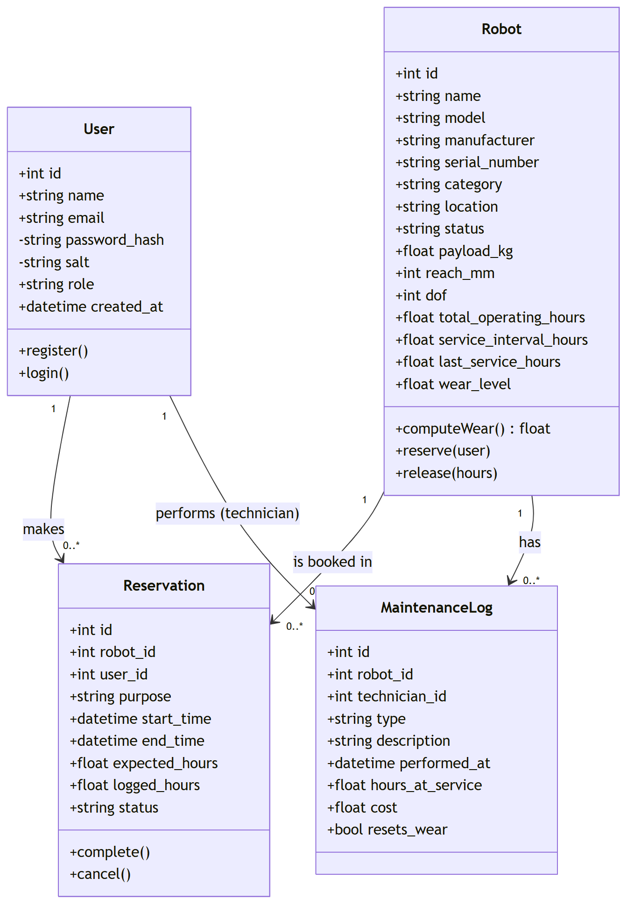

### 5.4 Sequence and Activity Diagrams
**Sequence — "Reserve a free robot":**

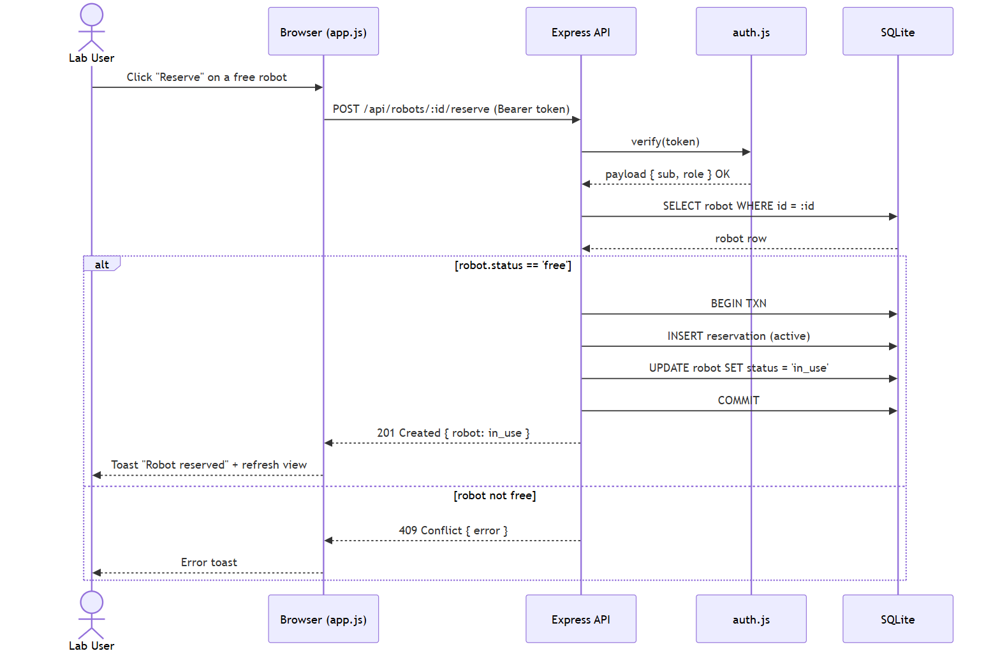

**Activity — robot usage & maintenance lifecycle:**

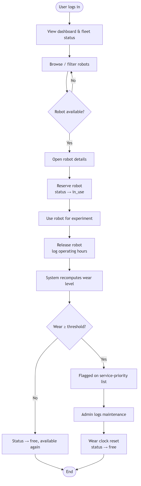

### 5.5 ER Diagram / Database Design
Four tables with enforced foreign keys. `reservations` and `maintenance_logs` reference both `robots`
and `users`; deleting a robot cascades to its reservations and logs.

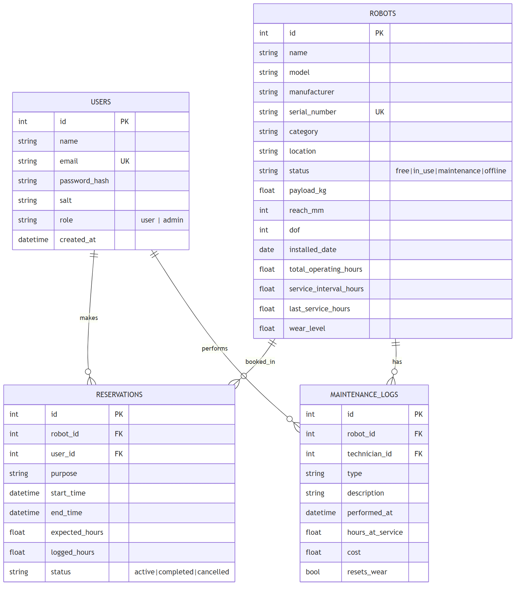

**Key design points**
- `robots.status ∈ {free, in_use, maintenance, offline}` and `reservations.status ∈ {active, completed, cancelled}`
  are enforced with `CHECK` constraints.
- Wear is **stored** (`wear_level`) for fast dashboard queries but always **derived** from
  `total_operating_hours`, `last_service_hours` and `service_interval_hours`, so it can be recomputed.
- Unique constraints on `users.email` and `robots.serial_number` prevent duplicates.

### 5.6 UI Design / Wireframes
The interface uses a persistent left sidebar for navigation, a top bar with the signed-in user and
role, and a content area that swaps between views. Status is colour-coded consistently
(green = free, amber = in use, red = maintenance, grey = offline); wear bars shade green→amber→red.
The realised screens are shown in §9.

---

## 6. Implementation

### 6.1 Technology Stack
| Layer | Technology | Why |
|---|---|---|
| Frontend | HTML5, CSS3, vanilla JS (SPA) | No build step; fast to load; full control of the UI |
| Backend | Node.js + Express.js | Lightweight, ubiquitous, excellent for JSON REST APIs |
| Database | SQLite via built-in `node:sqlite` | Zero-config, serverless, relational, integrity constraints |
| Security | `crypto` scrypt + HMAC-SHA256 tokens | Strong hashing & stateless sessions with no extra dependency |
| Testing | `node:test` + `fetch` | Built-in unit + HTTP integration tests |

### 6.2 Module Description
| Module | Responsibility |
|---|---|
| `server/index.js` | App entry: middleware, route mounting, static hosting, server start |
| `server/config.js` | Centralised configuration (port, DB path, secret, wear thresholds) |
| `server/db.js` | Opens SQLite, enables foreign keys, creates schema |
| `server/auth.js` | Password hashing, token sign/verify, `requireAuth`/`requireAdmin` middleware |
| `server/helpers.js` | Pure wear model, health banding, input validation |
| `server/seed.js` | Representative sample fleet, users, reservations and maintenance history |
| `server/routes/auth.js` | Register, login, current-user |
| `server/routes/robots.js` | Robot CRUD, reserve, release, maintenance |
| `server/routes/reservations.js` | Own/all reservation listing |
| `server/routes/users.js` | User administration |
| `server/routes/stats.js` | Dashboard aggregates |
| `public/js/app.js` | SPA controller: routing, rendering, actions |
| `public/js/api.js` | Fetch wrapper + token storage |

### 6.3 Key Code Snippets
*(Full source is on GitHub — see Appendix A.)*

**The wear model** (`server/helpers.js`):
```js
function computeWear(totalHours, lastServiceHours, serviceIntervalHours) {
  if (!serviceIntervalHours || serviceIntervalHours <= 0) return 0;
  const used = totalHours - lastServiceHours;
  const pct = (used / serviceIntervalHours) * 100;
  return Math.max(0, Math.min(100, Math.round(pct * 10) / 10));
}
```

**Atomic reserve** (`server/routes/robots.js`) — the status check and update run in one transaction so
two users cannot reserve the same robot:
```js
if (robot.status !== 'free')
  return res.status(409).json({ error: `Robot is not available (current status: ${robot.status})` });

db.prepare('BEGIN').run();
db.prepare(`INSERT INTO reservations (robot_id, user_id, purpose, expected_hours, status)
            VALUES (?, ?, ?, ?, 'active')`).run(robot.id, req.user.sub, purpose, expectedHours);
db.prepare("UPDATE robots SET status = 'in_use' WHERE id = ?").run(robot.id);
db.prepare('COMMIT').run();
```

**Password hashing** (`server/auth.js`):
```js
function hashPassword(password) {
  const salt = crypto.randomBytes(16).toString('hex');
  const hash = crypto.scryptSync(password, salt, 64).toString('hex');
  return { salt, hash };
}
```

---

## 7. Software Tools Used

> This section documents the tools used across the SDLC. Replace the *[INSERT SCREENSHOT]* placeholders
> with your own captures as noted; the diagrams and application outputs shown elsewhere in this report
> were produced with the tools below.

### 7.1 Tool 1 — Visual Studio Code (IDE)
- **Purpose:** primary code editor / IDE.
- **Usage in this project:** authored all backend and frontend source, used the integrated terminal to
  run `npm start` and `npm test`, and the debugger/Problems panel to catch issues.

> **[INSERT SCREENSHOT 7.1]** — VS Code open on the `robot-manipulator-management-system` folder
> showing the file tree and an open source file (e.g. `server/routes/robots.js`).
> *Caption: Fig 7.1 — Project developed in Visual Studio Code.*

### 7.2 Tool 2 — Git & GitHub (Version Control)
- **Purpose:** source-code version control and hosting.
- **Usage in this project:** tracked changes across sprints and published the repository with a README
  and setup instructions (Appendix A).

> **[INSERT SCREENSHOT 7.2]** — the GitHub repository page showing the file list and README.
> *Caption: Fig 7.2 — Source code hosted on GitHub.*

### 7.3 Tool 3 — Node.js & npm (Runtime / Build)
- **Purpose:** JavaScript runtime and package manager; also runs the test suite.
- **Usage in this project:** `npm install`, `npm start`, `npm test`, `npm run seed`.

> *The actual `npm test` console output is shown in §8.3 (Fig 8.1).*
> **[OPTIONAL SCREENSHOT 7.3]** — your terminal showing `npm start` printing the running URL.
> *Caption: Fig 7.3 — Application started with Node.js.*

### 7.4 Tool 4 — Mermaid / draw.io (UML & ER Diagramming)
- **Purpose:** authoring the architecture, use case, class, sequence, activity and ER diagrams.
- **Usage in this project:** all diagrams in §5 were produced as Mermaid definitions and rendered to
  images (equivalent diagrams can be drawn in draw.io/StarUML).

*The rendered diagrams appear throughout §5 (Figs 5.1–5.6).*

### 7.5 Tool 5 — Chrome DevTools / Postman (API Testing & Debugging)
- **Purpose:** inspecting network requests and manually testing REST endpoints.
- **Usage in this project:** verified status codes and JSON payloads for login, robot listing and the
  reserve/release flow during development.

> **[INSERT SCREENSHOT 7.5]** — Postman (or the DevTools Network tab) showing a `POST /api/auth/login`
> request returning `200` with a token, or `GET /api/stats` returning the dashboard JSON.
> *Caption: Fig 7.5 — REST API tested with Postman / DevTools.*

### 7.6 Summary Table
| Tool | Purpose | Phase of SDLC | Usage in project |
|---|---|---|---|
| Visual Studio Code | Code editor / IDE | Implementation | Writing & debugging all source |
| Git & GitHub | Version control & hosting | All phases | Change tracking, repository hosting |
| Node.js & npm | Runtime, build, test runner | Implementation, Testing | Running the server & test suite |
| Mermaid / draw.io | UML & ER diagramming | Design | Architecture, UML, ER diagrams |
| Chrome DevTools / Postman | API testing & debugging | Testing | Verifying endpoints & payloads |

---

## 8. Testing

### 8.1 Test Plan and Strategy
Testing combined **unit testing** of pure logic (wear model, validation, password hashing, token
signing) with **integration testing** of the live REST API over HTTP on an ephemeral port, using
Node's built-in `node:test` runner. The strategy targets:
- correctness of the **wear computation** and its boundaries (0% and 100% caps);
- **authentication** correctness (valid login, wrong password, tampered token);
- **authorisation** (unauthenticated and non-admin requests are blocked);
- the **reservation lifecycle** (reserve → in_use → release → hours & wear updated);
- **business rules** (cannot reserve a non-free robot).

Run with `npm test`.

### 8.2 Test Cases
| ID | Test case | Input | Expected output | Actual output | Status |
|---|---|---|---|---|---|
| TC1 | Wear at mid-interval | 1000 h used of 2000 h | 50% | 50% | ✅ Pass |
| TC2 | Wear caps / floors | 9000/2000 and 0/2000 | 100% and 0% | 100% and 0% | ✅ Pass |
| TC3 | Wear band thresholds | 10, 75, 95 | healthy, warning, critical | healthy, warning, critical | ✅ Pass |
| TC4 | Robot validation | empty body | ≥ 6 field errors | 6 errors | ✅ Pass |
| TC5 | Password hash round-trip | correct & wrong password | true / false | true / false | ✅ Pass |
| TC6 | Token sign/verify + tamper | valid & tampered token | role=admin / null | role=admin / null | ✅ Pass |
| TC7 | Login valid admin | admin@rmms.io / admin123 | 200 + token, role=admin | 200 + token | ✅ Pass |
| TC8 | Login wrong password | admin@rmms.io / nope | 401 | 401 | ✅ Pass |
| TC9 | Unauthenticated list | GET /api/robots (no token) | 401 | 401 | ✅ Pass |
| TC10 | Authenticated list | GET /api/robots (token) | 200 + robot array | 200 + 12 robots | ✅ Pass |
| TC11 | Stats consistency | GET /api/stats | status counts sum to total | sum = total | ✅ Pass |
| TC12 | Reserve then release | reserve + release 2 h | in_use → free, +2 h | in_use → free, +2 h | ✅ Pass |
| TC13 | Reserve non-free robot | reserve a maintenance robot | 409 Conflict | 409 | ✅ Pass |
| TC14 | Non-admin creates robot | user POST /api/robots | 403 Forbidden | 403 | ✅ Pass |

### 8.3 Test Results and Bug Log
**Result:** **14 / 14 tests pass.** Console output:

```
✔ computeWear: midway through interval
✔ computeWear: caps at 100 and never negative
✔ wearBand: thresholds map to bands
✔ validateRobotPayload: flags missing required fields
✔ password hashing round-trips and rejects wrong password
✔ token sign/verify works and rejects tampering
✔ login with valid admin credentials returns a token
✔ login with wrong password is rejected (401)
✔ unauthenticated request to /api/robots is blocked (401)
✔ authenticated user can list robots
✔ dashboard stats add up to the fleet size
✔ reserve then release a free robot updates status and operating hours
✔ reserving a robot that is not free is rejected (409)
✔ non-admin cannot create a robot (403)
ℹ tests 14   ℹ pass 14   ℹ fail 0
```
*Fig 8.1 — `npm test` results.*

**Bug log (defects found and fixed during development)**
| Bug ID | Description | Severity | Resolution | Status |
|---|---|---|---|---|
| BUG1 | Deleting a robot left orphaned reservation/maintenance rows | High | Enabled `PRAGMA foreign_keys = ON` and added `ON DELETE CASCADE` | Fixed |
| BUG2 | Wear could exceed 100% for very high hours | Medium | Clamped `computeWear()` to the range 0–100 | Fixed |
| BUG3 | A non-owner saw an enabled "Release" button | Low | Server enforces owner/admin on release (403); button is advisory only | Fixed |
| BUG4 | `/api/*` unknown routes returned the SPA HTML instead of JSON | Low | Added a JSON 404 handler scoped to `/api` before the static fallback | Fixed |

---

## 9. Results and Discussion

### 9.1 Output Screenshots of the Working System

**Login screen** — role-based authentication with demo accounts.
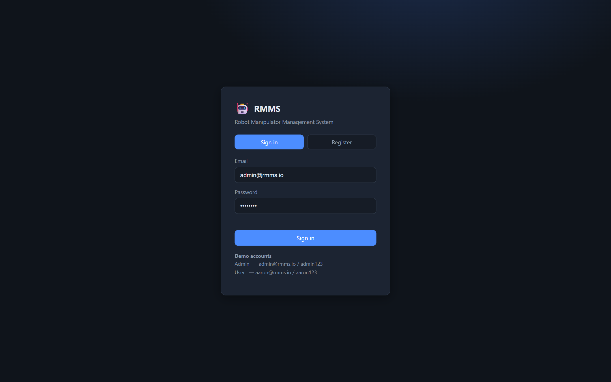
*Fig 9.1 — Login / registration screen.*

**Administrator dashboard** — fleet counts, utilisation, wear distribution, category breakdown and a
service-priority list of the highest-wear robots.

*Fig 9.2 — Dashboard with live fleet analytics.*

**Robot fleet** — searchable, filterable grid with status pills and wear bars.
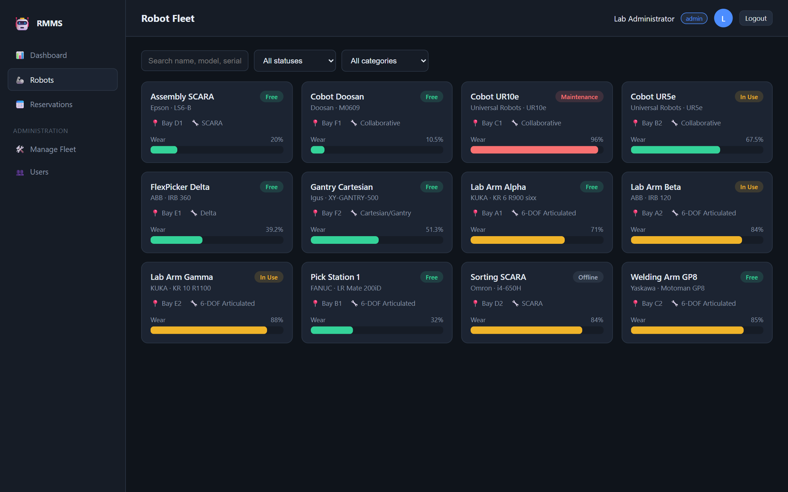
*Fig 9.3 — Robot fleet browser.*

**Robot details** — full specifications, wear level and maintenance history, with contextual actions.
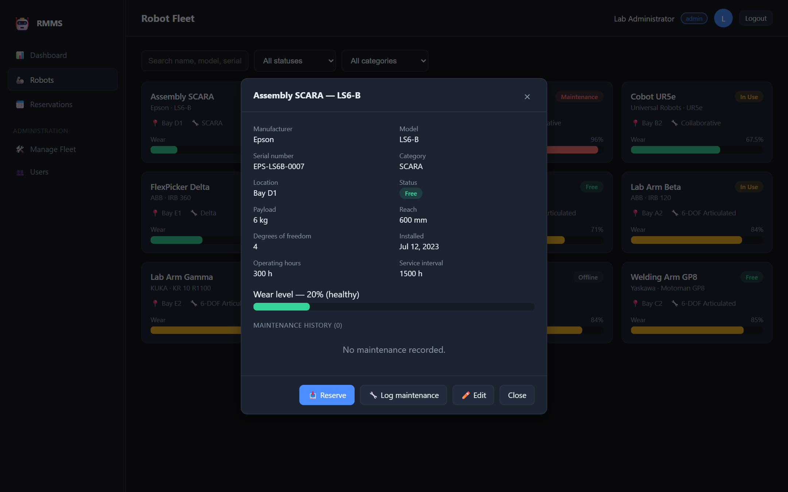
*Fig 9.4 — Robot detail with actions.*

**Reserve dialog** — checking a free robot out for a stated purpose and expected hours.
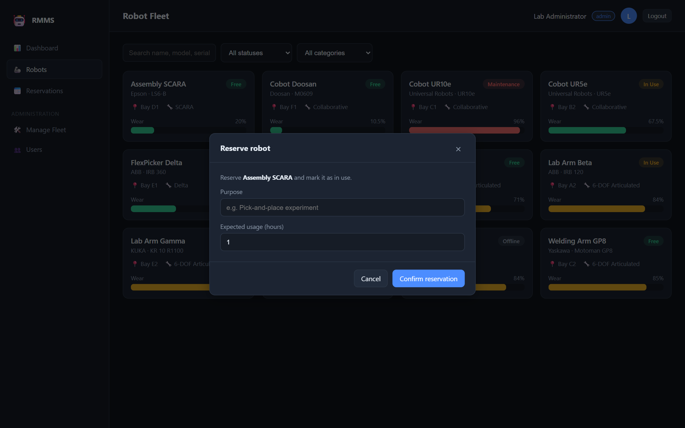
*Fig 9.5 — Reservation dialog.*

**Reservations** — the signed-in user's reservation history (admins can view all).
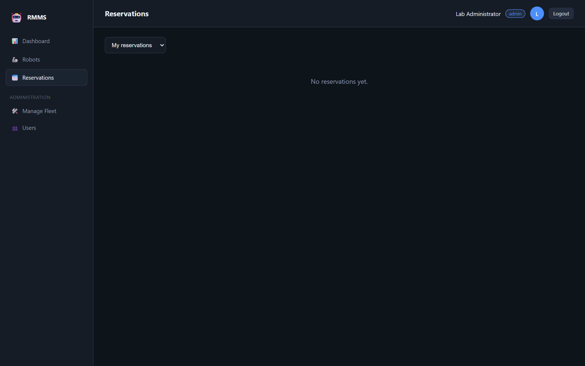
*Fig 9.6 — Reservations view.*

**Manage fleet (admin)** — table view with add / edit / delete.
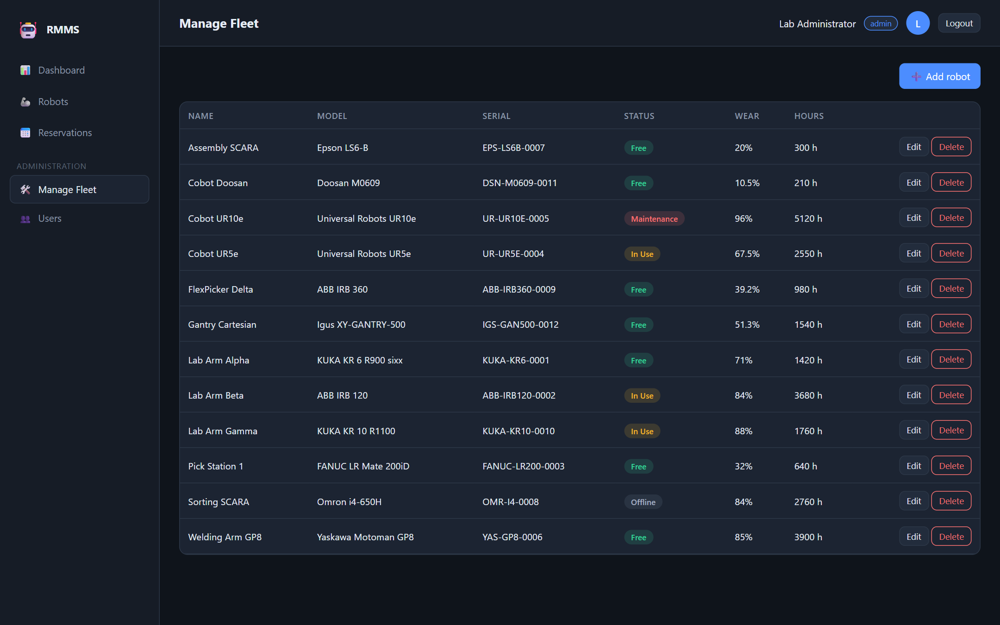
*Fig 9.7 — Administrative fleet management.*

**Add / edit robot (admin)** — full specification form with validation.
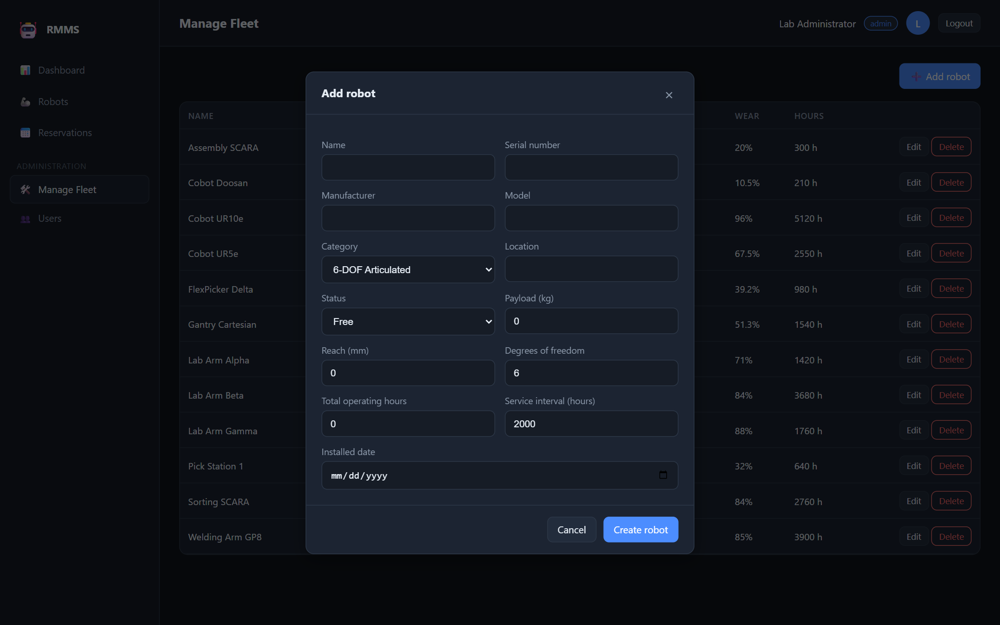
*Fig 9.8 — Add/edit robot form.*

**User management (admin)** — promote/demote and remove users.
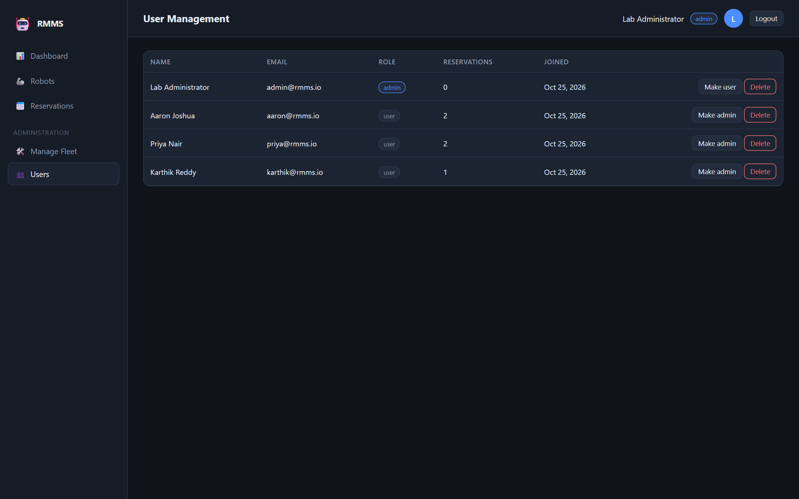
*Fig 9.9 — User management.*

**Standard-user view** — the same dashboard with administrative navigation hidden (RBAC).
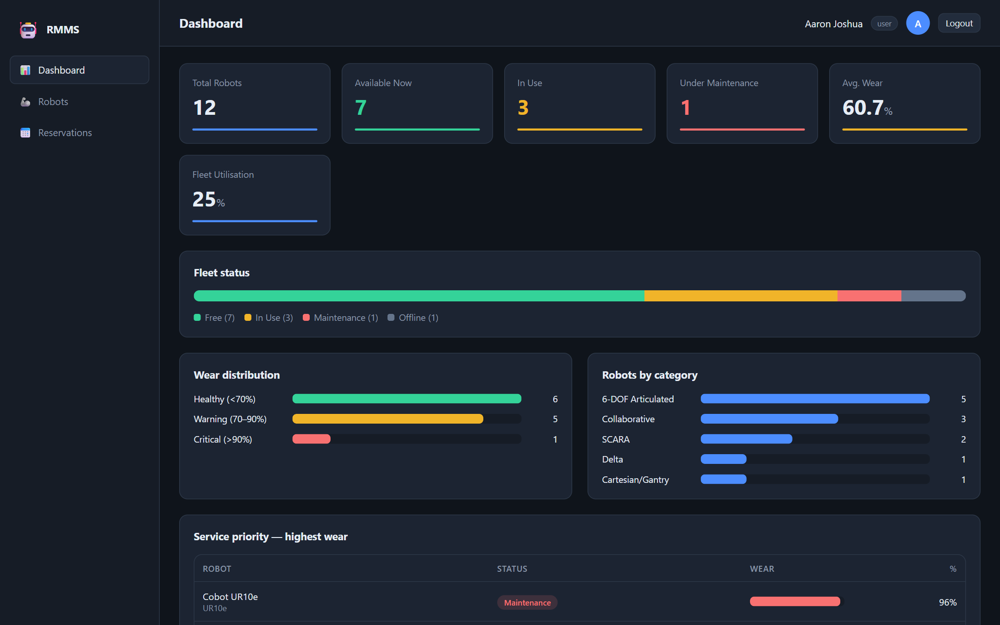
*Fig 9.10 — User role sees no admin tools.*

### 9.2 Analysis Against Objectives
| Objective | Outcome |
|---|---|
| Centralised dashboard | ✅ Delivered — counts, utilisation, wear & category charts, service-priority list |
| Robot catalogue with search/filter | ✅ Delivered — grid with status/category/text filters and detail view |
| Reservation workflow | ✅ Delivered — atomic reserve/release with conflict prevention |
| Automatic wear modelling | ✅ Delivered — hours accrue on release; wear recomputed and banded |
| Admin fleet & maintenance management | ✅ Delivered — CRUD + maintenance logging with wear reset |
| Role-based access control | ✅ Delivered — user/admin separation enforced on client and server |
| Responsive, usable UI | ✅ Delivered — dark responsive SPA, consistent colour-coding |

All seven objectives were met. The automated test suite (14/14 passing) gives confidence in the core
logic, and the live screenshots demonstrate each feature end-to-end. The main limitation remains the
absence of live hardware telemetry, addressed below.

---

## 10. Conclusion and Future Enhancements

### Conclusion
RMMS successfully delivers a vendor-neutral, web-based platform that unifies **availability/reservation**
and **wear/maintenance tracking** for a mixed fleet of robotic manipulators — a combination the existing
tools surveyed in §2 do not provide together. Built with a clean three-tier architecture, a documented
REST API, enforced data integrity and an automated test suite, it meets all stated objectives and is
simple to deploy in a laboratory.

### Future Enhancements
1. **Live hardware telemetry** — integrate with robot controllers (ROS 2 / OPC-UA / vendor SDKs) to read
   operating hours and fault codes automatically instead of logging them manually.
2. **Calendar-based booking** — reserve future time slots with conflict detection and a calendar view.
3. **Predictive maintenance** — use historical wear/fault data to forecast failures (condition-based).
4. **Notifications** — email/push alerts when a robot crosses the warning/critical wear threshold.
5. **Analytics & export** — utilisation reports and CSV/PDF export for lab administrators.
6. **Audit trail & 2FA** — full action logging and two-factor authentication for administrators.
7. **Containerised deployment** — Docker image and migration to PostgreSQL for larger, multi-lab use.

---

## 11. References
[1] I. Sommerville, *Software Engineering*, 10th ed. Harlow, U.K.: Pearson, 2016.

[2] R. S. Pressman and B. R. Maxim, *Software Engineering: A Practitioner's Approach*, 8th ed. New York, NY, USA: McGraw-Hill, 2015.

[3] K. Schwaber and J. Sutherland, "The Scrum Guide," Scrum.org, 2020. [Online]. Available: https://scrumguides.org

[4] OpenJS Foundation, "Node.js Documentation — SQLite (`node:sqlite`)," 2025. [Online]. Available: https://nodejs.org/api/sqlite.html

[5] OpenJS Foundation, "Express.js — Fast, unopinionated, minimalist web framework for Node.js," 2024. [Online]. Available: https://expressjs.com

[6] SQLite Consortium, "SQLite — Foreign Key Support," 2024. [Online]. Available: https://www.sqlite.org/foreignkeys.html

[7] International Organization for Standardization, *ISO 8373:2021 — Robotics — Vocabulary*, Geneva, Switzerland, 2021.

[8] Object Management Group, *Unified Modeling Language (UML) Specification, v2.5.1*, 2017. [Online]. Available: https://www.omg.org/spec/UML

---

## 12. Appendices

### Appendix A: Project Links
- **GitHub repository:** `https://github.com/<your-username>/robot-manipulator-management-system`
  *(replace with your actual URL; the repo is public and includes a README with setup steps).*
- **Demo video (Google Drive):** `https://drive.google.com/file/d/<your-file-id>/view?usp=sharing`
  *(set sharing to "Anyone with the link can view"; verify it opens in an incognito window).*

### Appendix B: Sample Code Listings (Optional)
**Database schema** (`server/db.js`, abridged):
```sql
CREATE TABLE robots (
  id INTEGER PRIMARY KEY AUTOINCREMENT,
  name TEXT NOT NULL, model TEXT NOT NULL, manufacturer TEXT NOT NULL,
  serial_number TEXT NOT NULL UNIQUE,
  category TEXT NOT NULL, location TEXT NOT NULL,
  status TEXT NOT NULL DEFAULT 'free'
         CHECK (status IN ('free','in_use','maintenance','offline')),
  payload_kg REAL, reach_mm INTEGER, dof INTEGER,
  total_operating_hours REAL NOT NULL DEFAULT 0,
  service_interval_hours REAL NOT NULL DEFAULT 2000,
  last_service_hours REAL NOT NULL DEFAULT 0,
  wear_level REAL NOT NULL DEFAULT 0
);

CREATE TABLE reservations (
  id INTEGER PRIMARY KEY AUTOINCREMENT,
  robot_id INTEGER NOT NULL REFERENCES robots(id) ON DELETE CASCADE,
  user_id  INTEGER NOT NULL REFERENCES users(id)  ON DELETE CASCADE,
  purpose TEXT, start_time TEXT, end_time TEXT,
  expected_hours REAL, logged_hours REAL,
  status TEXT NOT NULL DEFAULT 'active'
         CHECK (status IN ('active','completed','cancelled'))
);
```

**Release endpoint with wear recomputation** (`server/routes/robots.js`, abridged):
```js
const loggedHours = Number(req.body.logged_hours) || reservation.expected_hours || 1;
const newTotal = robot.total_operating_hours + loggedHours;
const newWear = computeWear(newTotal, robot.last_service_hours, robot.service_interval_hours);
// ...inside a transaction:
db.prepare("UPDATE reservations SET status='completed', end_time=datetime('now'), logged_hours=? WHERE id=?")
  .run(loggedHours, reservation.id);
db.prepare("UPDATE robots SET status='free', total_operating_hours=?, wear_level=? WHERE id=?")
  .run(newTotal, newWear, robot.id);
```

---

<div align="center">

*Robot Manipulator Management System — Software Engineering Project*
**Aaron Joshua · 24BRS1393 · VIT Chennai**

</div>
